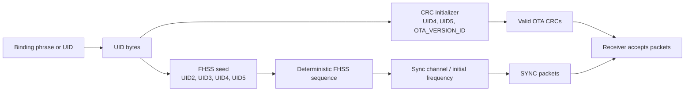
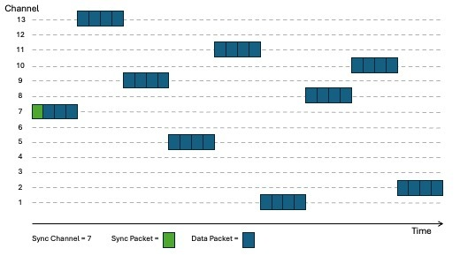
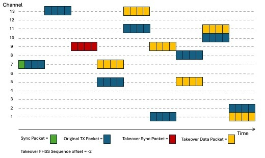
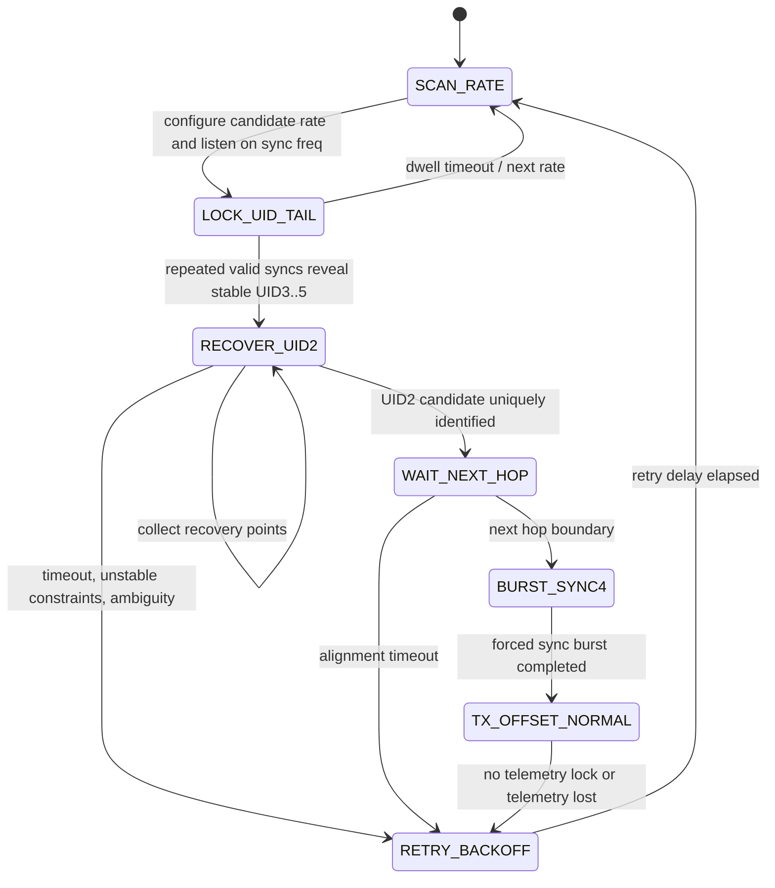

# ExpressLRS Takeover Research Writeup

ExpressLRS sync packets expose UID-derived material and synchronization state. The CRC seed and deterministic FHSS schedule are recoverable by passive observation, leaving only an 8-bit UID component to brute-force from timing observations. A transmitter that reconstructs the UID seed can emit valid sync and RC packets and move the receiver to its own hop schedule. This demonstrates that the current OTA protocol should not be treated as authenticated or takeover-resistant.

Demo video at: [https://youtu.be/5zOS8fbnUUo](https://youtu.be/5zOS8fbnUUo)

## Protocol Mechanics

### UID and Derived Values

ExpressLRS keeps a 6-byte `UID` in `src/src/common.cpp`. In normal use this comes from the binding phrase or configured identity. The air protocol does not use all six bytes equally:

- `UID[4]` and `UID[5]` are used to derive `OtaCrcInitializer`.
- `UID[2]`, `UID[3]`, `UID[4]`, and `UID[5] ^ OTA_VERSION_ID` are packed into the 32-bit FHSS seed by `uidMacSeedGet()`.
- `UID[3]`, `UID[4]`, and `UID[5]` are transmitted in sync packets.

The relevant formulas are:

```text
OtaCrcInitializer = (UID[4] << 8) | UID[5]
OtaCrcInitializer ^= OTA_VERSION_ID

uidMacSeed = (UID[2] << 24) | (UID[3] << 16) | (UID[4] << 8) | (UID[5] ^ OTA_VERSION_ID)
```

A passive listener that receives a valid sync packet learns `UID3..UID5`. That gives the CRC seed and leaves only `UID2` unknown for the FHSS seed.

### OTA Packet Types

The low two bits of the first OTA byte identify packet type:

| Type bits | Name | Direction/use |
| --- | --- | --- |
| `00` | `PACKET_TYPE_RCDATA` | Uplink RC channel data |
| `01` | `PACKET_TYPE_MSPDATA` | Uplink MSP/control data |
| `10` | `PACKET_TYPE_SYNC` | Uplink sync/control-plane packet |
| `11` | `PACKET_TYPE_TLM` | Downlink telemetry |

The two main packet layouts are:

- Standard packet: `OTA4_PACKET_SIZE == 8`, CRC14.
- Full-resolution packet: `OTA8_PACKET_SIZE == 13`, CRC16.

The sync payload is the critical structure:

| Field | Meaning | Takeover relevance |
| --- | --- | --- |
| `fhssIndex` | Current index in the FHSS sequence | Lets the receiver align to the transmitter schedule |
| `nonce` | Packet counter modulo 256 | Lets the receiver align packet timing and hop boundaries |
| `switchEncMode` | Switch/channel encoding mode | Lets receiver choose the right unpacker |
| `newTlmRatio` | Telemetry ratio command | Controls downlink timing |
| `rateIndex` | Air-rate table index | Identifies modulation, interval, payload length, hop interval |
| `UID3` | UID byte included in FHSS seed | Leaked in clear |
| `UID4` | UID byte included in FHSS seed and CRC seed | Leaked in clear |
| `UID5` | UID byte included in FHSS seed and CRC seed | Leaked in clear, except model-match may XOR sync field |

### Sync Packets

The transmitter fills sync packets in `GenerateSyncPacketData()` in `src/src/tx_main.cpp`. The packet includes current FHSS pointer, current nonce, current rate, telemetry ratio, switch encoding, and UID bytes.

Sync packets are sent on the sync channel. The sync channel is deterministic for the regulatory domain:

```text
sync_channel = (frequency_count / 2) + 1
initial_sync_frequency = freq_start + sync_channel * freq_spread
```

The transmitter sends normal sync packets only when the current FHSS entry is the sync channel and the configured sync interval has elapsed. It may also send sync spam after rate/config changes. The takeover code uses the same sync machinery, but overrides selected fields during the forced takeover burst.

### FHSS Schedule Generation

The frequency-hop schedule is deterministic. `FHSSrandomiseFHSSsequence()` chooses the regulatory-domain frequency table, sets the sync channel, computes channel spacing, and calls `FHSSrandomiseFHSSsequenceBuild(seed, freq_count, sync_channel, sequence)`.

The sequence builder:

1. Allocates a 256-entry sequence, truncated to a whole number of domain-frequency blocks.
2. Places the sync channel at the first entry of every frequency-count block.
3. Fills the rest of each block with the other channel indices.
4. Applies a deterministic LCG shuffle inside each block using the UID-derived seed.

The PRNG is the simple LCG in `src/lib/FHSS/random.cpp`:

```text
seed = (214013 * seed + 2531011) mod 2^31
rand = seed >> 16
```


### FHSS and Nonce Timing

The transmitter increments `OtaNonce` on each timer tick. A hop occurs every `FHSShopInterval` packets. In the TX path:

```text
if ((OtaNonce + 1) % FHSShopInterval == 0)
    advance to next FHSS sequence index
```

The sync packet carries both `nonce` and `fhssIndex`, so a receiver can realign if it hears sync. The same behavior gives a passive observer enough timing information to infer where later packets should occur in the sequence.

## Visual Model of the Protocol

### Packet and Schedule Overview



### FHSS Schedule Shape



## Why Takeover Is Possible

### Step 1: Find the Air Rate and Sync Channel

The takeover module starts in `SCAN_RATE`. It builds a scan order from the configured rate followed by supported sub-GHz rates. For each rate it:

- Stops normal TX.
- Calls `SetRFLinkRate(rateIndex)` so radio modulation and packet length match the candidate air rate.
- Sets continuous RX timeout.
- Listens on `FHSSgetInitialFreq()`, the sync frequency.
- Toggles IQ polarity on repeated scan passes by temporarily flipping the low bit of `UID[5]`, because `SetRFLinkRate()` derives IQ inversion from binding mode or `UID[5] & 1`.


### Step 2: Recover `UID3..UID5`

Once a sync packet is received, the demo reads `UID3`, `UID4`, and `UID5` directly from the sync payload. It then validates the packet CRC by temporarily installing `UID4` and `UID5` as the local CRC seed.

The final code requires repeated matching sync observations (`UID_LOCK_COUNT == 3`) before treating the UID tail as stable.

Important limitation: normal ExpressLRS model match can XOR part of `UID5` in the sync field. Earlier history attempted to brute-force the model-match XOR, but the final code in this branch validates with the sync `UID5` directly. The current demo is therefore best understood as targeting model-match-off links or links where the wire `UID5` still matches the CRC seed.

### Step 3: Recover `UID2`

After `UID3..UID5` are known, the FHSS seed is unknown only in its high byte:

```text
candidateSeed = (candidateUID2 << 24) |
                (UID3 << 16) |
                (UID4 << 8) |
                (UID5 ^ OTA_VERSION_ID)
```

There are only 256 candidates.

The challenge is to identify which candidate produces the observed hop schedule. The demo captures "recovery points":

```text
recovery point = {
    startIndex: sync.fhssIndex,
    distanceHops: measured hops from sync index to reference channel,
    referenceChannel: channel listened to after sync
}
```

For each candidate `UID2`, the demo reconstructs the FHSS sequence using the same algorithm as ExpressLRS and checks:

- The observed `startIndex` is a sync-channel entry.
- Walking forward from `startIndex`, the candidate sequence reaches `referenceChannel` after `distanceHops`.
- All collected recovery points agree.

The current code first tries exact matching, then falls back to +/- 1 hop tolerance for timing-edge cases. If multiple candidates remain, it collects more points and may switch to another reference channel. If no candidate matches, it rejects the newest point as unstable and retries.

### Step 4: Predict Current Link State

Once `UID2` is recovered, the takeover firmware can become a protocol-compatible transmitter:

- It writes the recovered `UID[2]`.
- It recomputes `OtaCrcInitializer`.
- It rebuilds the FHSS sequence using `FHSSrandomiseFHSSsequence(uidMacSeedGet())`.
- It configures runtime state from the last observed sync: rate, switch encoding, and telemetry ratio.
- It predicts the current `OtaNonce` and FHSS index by comparing `micros()` with the timestamp of the last sync and advancing by the air-rate packet interval.

That gives the proof of concept a valid seed, valid CRC initializer, valid packet serializer, and a current estimate of where the receiver expects the transmitter to be.

### Step 5: Force a Sync Burst

The takeover transmitter waits until a hop boundary, then enters `BURST_SYNC4` and forces sync packets through the normal TX path.

During the forced burst, `OverrideSyncFields()` preserves the victim-observed sync metadata:

- `rateIndex`
- `switchEncMode`
- `newTlmRatio`
- `UID3`
- `UID4`
- `UID5`

For forced burst packets it also advertises an `fhssIndex` shifted ahead by the chosen takeover offset:

```text
forced_sync.fhssIndex = current_takeover_index + computed_fhss_offset
```

After the burst completes, `OnTxDone()` applies the same offset locally:

```text
local FHSS index = local FHSS index + computed_fhss_offset
```

This tries to move the receiver onto the attacker's offset schedule.

### Step 6: Continue Offset Transmission

After the burst, the takeover state becomes `TX_OFFSET_NORMAL`. The transmitter sends normal RC/MSP packets using the recovered UID and offset FHSS pointer. It monitors telemetry as a success signal:

- If telemetry appears, the link is considered seen.
- If no telemetry appears after the stabilization window, it backs off and retries.
- If telemetry is later lost beyond the loss window, it backs off and retries.

The latest commit computes an offset that minimizes channel collisions between the original transmitter and the takeover transmitter for the recovered sequence. That does not authenticate anything; it just improves the practical chance that the offset transmitter can stay usable while the original transmitter is still present.



## Takeover State Machine




## Collision-Avoidance Offset

The takeover transmitter should not stay on exactly the same FHSS index as the original transmitter. If both transmit at the same time on the same frequency, they collide. The demo instead advertises and applies an offset into the same recovered sequence.

The latest code computes:

```text
for offset in 1..sequenceCount-1:
    collisions = count(sequence[i] == sequence[(i + offset) % sequenceCount])
choose offset with minimum collisions
```

## Security Interpretation

The takeover works because ExpressLRS identity checks are deterministic and observable:

- CRC validates accidental corruption, not malicious packets.
- Sync leaks UID material and synchronization state.
- FHSS is deterministic and keyed by only one unknown byte after sync is observed.
- The receiver has no cryptographic proof that sync or RC packets came from the bound transmitter.
- A stronger or well-timed second transmitter can provide plausible sync and RC packets.

Model match should not be considered a defense. In this code, model match modifies sync `UID5` with a 6-bit XOR intended to prevent accidental wrong-model control. It is not a cryptographic authentication scheme.


